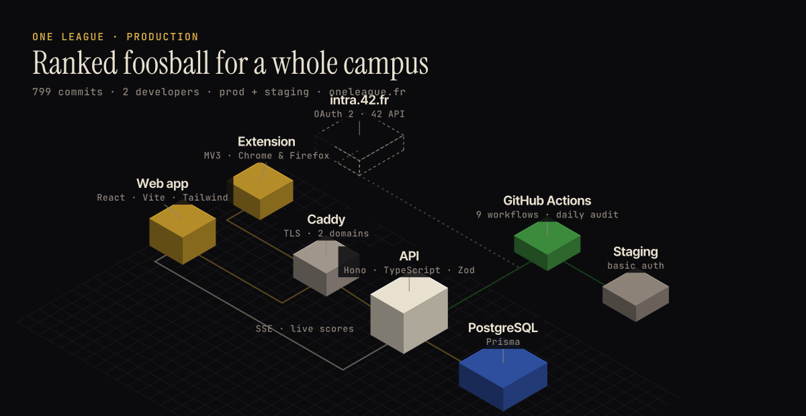
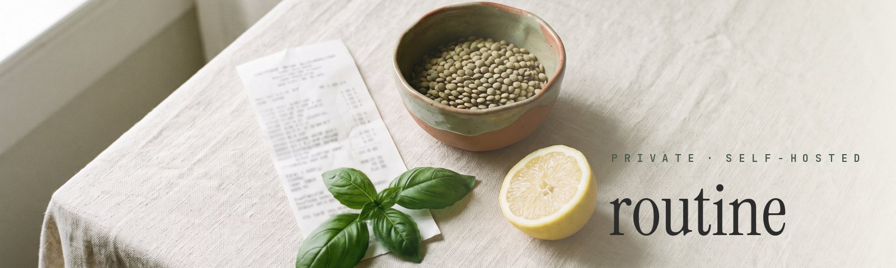
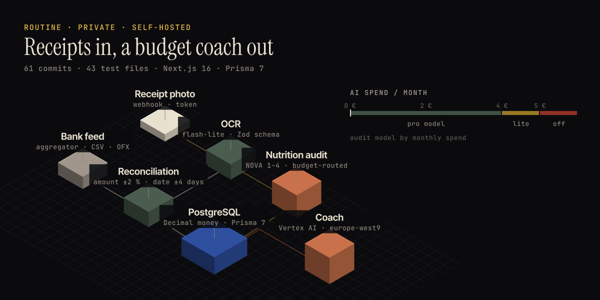
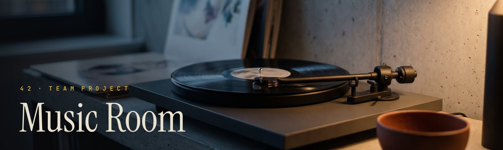
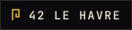
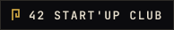
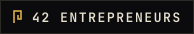
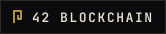

Rendered from <a href="https://github.com/4drie2/minos3D">minos3D</a>'s own map and textures, same DDA raycasting.

 

Work-study student at 42 Le Havre. C and C++ for school; TypeScript for two products that run on a server I administer.

 

## I. Shipped

An unofficial ranked foosball league for 42 students, now also chess, Smash, Street Fighter and darts. You sign in with the 42 intranet, declare a match from a browser extension that lives inside intra.42.fr, and both players confirm the score. Elo with an anti-farming rule, live updates over SSE, tournaments, seasons, a GDPR export and delete.

I administer the project's GitHub organisation and its server. Production and staging deploy from GitHub Actions, and a security audit runs every morning. The repository is private; the site is open to every 42 student.

 

A budget and food coach I built for myself. A photo of a receipt goes through OCR, a nutrition audit, then a reconciliation engine that pairs it with the bank transaction (amount within 2 %, date within 4 days). The audit model depends on what the month has already cost: the larger model up to 4 €, a lighter one up to 5 €, then the audit stops while OCR keeps running. The coach runs on Vertex AI in Paris. Private, self-hosted next to One League.

 

Collaborative listening rooms, a 42 subject built in a team. NestJS on Fastify, Drizzle, PostgreSQL, socket.io, React. My part: Spotify sign-in and account linking with token refresh, fixes on the Google flow, most of the front end. 85 of the repository's 105 commits, written in one week.

 

## II. The labyrinth

<a href="https://github.com/4drie2/libft">libft</a> ·
<a href="https://github.com/4drie2/get_next_line">get_next_line</a> ·
<a href="https://github.com/4drie2/ft_printf">ft_printf</a> ·
<a href="https://github.com/4drie2/pipex">pipex</a> ·
<a href="https://github.com/4drie2/push_swap">push_swap</a> ·
<a href="https://github.com/4drie2/fractol">fract-ol</a> ·
<a href="https://github.com/4drie2/philosophers">philosophers</a> ·
minishell (private) ·
<a href="https://github.com/4drie2/minos3D">minos3D</a> ·
<a href="https://github.com/4drie2/CPP00">CPP 00</a>–<a href="https://github.com/4drie2/cpp09">09</a> ·
<a href="https://github.com/4drie2/inception">Inception</a> ·
<a href="https://github.com/4drie2/python_data_science-0-starting">Python</a>

  

## III. Workshop

- [healthcheck](https://github.com/4drie2/healthcheck): a phone notification when a school session drops, without touching the lock screen. Written so classmates can set it up on their own.
- [csv-to-poster-room-pdf](https://github.com/4drie2/csv-to-poster-room-pdf): a CSV of room assignments in, one printable door card per room out.
- [SuperTripMaster](https://github.com/4drie2/SuperTripMaster): vehicle dashboard on an ESP32 with a 320×240 screen (speed, RPM, trip, temperatures, battery). LVGL, plus an SDL build to work without the board.
- [logtime](https://github.com/4drie2/logtime) and [WhoConnected](https://github.com/4drie2/WhoConnected): small tools on the 42 API, monthly log time and who is on campus right now.
- [kfs-1](https://github.com/4drie2/kfs1): Kernel From Scratch, part one, in progress. The course I write alongside the code is eleven chapters in.
- [42calculator](https://github.com/lucas-ht/42calculator/pull/71): a small fix proposed upstream to the 42 level calculator.

 

## IV. Ledger

 

<a href="https://www.linkedin.com/in/adrien-bidaux">LinkedIn</a> · <a href="https://www.flickr.com/photos/195770192@N05/">photographs</a>

